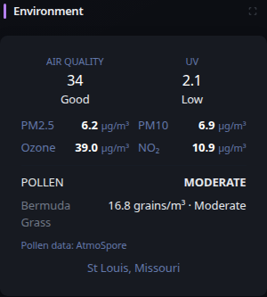
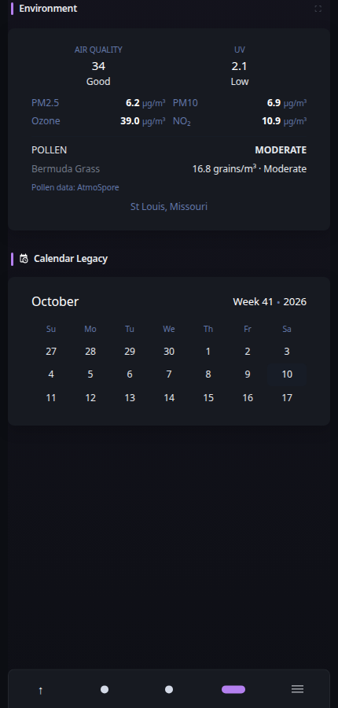

# Environment

[Widgets](../widgets.md) · [Configuration](../configuration.md) · [Glance README](../../README.md)

Display air quality, UV index, pollutant concentrations, and optional airborne allergen information. Air quality and UV data are provided by https://open-meteo.com/. Choose AtmoSpore for location-based pollen forecasts or St. Louis County for regional pollen and mold observations.


Environment supports [expanded widget views](../expanded-views.md). The compact view prioritizes current conditions, while the expanded presentation provides the additional pollutant, trend, forecast, and pollen detail described below.
## Quick start

```yaml
- type: environment
  location: St. Louis, Missouri, United States
```

To include pollen data:

```yaml
- type: environment
  location: St. Louis, Missouri, United States
  pollen-api-key: ${ATMOSPORE_API_KEY}
```

## Preview



**Mobile preview:**



The compact view emphasizes the current US AQI and UV index, followed by PM2.5, PM10, ozone, and nitrogen dioxide measurements. When an allergen provider is configured, it shows nonzero category levels for tree, grass, weed, and mold, identifies unavailable categories, and displays the report date and source. Up to three nonzero allergens are listed in order of risk level, concentration, then name.

Use the expand control in the widget header for additional detail. The expanded view includes US and European AQI, additional pollutant measurements, the available air-quality and UV forecast, and all allergens with nonzero or unavailable concentrations. Confirmed zero concentrations and category summaries are hidden in both views; unavailable data remains visible. AtmoSpore supplies a forecast timeline; St. Louis County supplies recent observation history. An earlier report is labeled explicitly and is never presented as today's conditions.

Missing or null current AQI, UV, and pollutant readings are shown as unavailable, rather than real zero measurements. Valid zero readings remain visible. A response without usable current or forecast readings fails the refresh and preserves previously available data.

Air quality and pollen are fetched independently. If one provider temporarily fails while previously fetched data is available, the widget keeps that data visible and reports the failed refresh rather than discarding data from the successful provider.

## Configuration

This widget also supports the [shared widget properties](../widgets.md#shared-properties).

| Property | Type | Required | Default |
| --- | --- | --- | --- |
| `location` | string | yes | — |
| `pollen-provider` | string | no | `atmospore` |
| `pollen-api-key` | string | no | — |

### `location`

The location to fetch environmental information for. Location resolution uses the same Open-Meteo geocoding resource as the Weather widget. Glance uses the first result when multiple locations match, so include the state or administrative area when needed to disambiguate common city names.

### `pollen-api-key`

Optional AtmoSpore API key used to add pollen conditions and forecast data. Air quality, UV, and pollutant measurements continue to work without this property.

Keep the API key outside the Glance configuration and reference it through an environment variable:

```yaml
- type: environment
  location: St. Louis, Missouri, United States
  pollen-api-key: ${ATMOSPORE_API_KEY}
```

Pollen concentrations are displayed in grains/m³. The widget uses AtmoSpore-provided risk classifications. Only nonzero concentrations appear in the compact species list; expanded detail includes nonzero and unavailable values. When every reported concentration is a confirmed zero, both views show a single empty-state message.

### `pollen-provider`

Choose `atmospore` (the default) or `st-louis-county`. Existing configurations with only `pollen-api-key` continue to use AtmoSpore. Without a key, the default provider stays disabled and air quality and UV continue to work.

| Provider | Coverage and data | API key | Expanded timeline |
| --- | --- | --- | --- |
| `atmospore` | Provider-advertised global, modeled pollen forecasts | Required | Up to seven forecast days |
| `st-louis-county` | St. Louis metropolitan area, measured pollen and mold observations | Not required | Up to seven reports from the previous fourteen days |

AtmoSpore forecasts are not local station measurements. Its supported categories are tree, grass, and weed pollen; mold is not provided. Category levels show the highest reported individual risk within each category, not a sum of concentrations. Some entries describe overlapping plant families and species, so their concentrations must not be added together. Missing classifications or concentrations make the affected category unavailable. The provider's advertised worldwide coverage does not establish accuracy at every location. See [AtmoSpore's API documentation](https://atmospore.com/api-docs).

For regional observations including mold:

```yaml
- type: environment
  location: O'Fallon, Missouri, United States
  pollen-provider: st-louis-county
```

Selecting St. Louis County is an explicit choice of a fixed regional source. Changing `location` does not move its sampling station; `location` still controls the air-quality and UV request. The widget labels the allergen source as regional. Do not select this provider for another region expecting local measurements.

The county provider requires no key and does not send `pollen-api-key`, even if that property remains configured. Its public website uses a JSON endpoint at `https://pollenandmoldcharts.stlouisco.com/Api/PollenMold/GetCounts/`. This is a website endpoint without a published developer API stability guarantee. Reports normally update on business days by 11 a.m.; weekends, holidays, or collection problems can leave an earlier report as the latest observation. See the [county report](https://pollenandmold.stlouisco.com/) and [collection methodology](https://pollenandmold.stlouisco.com/html/FAQ.html).

County category levels use its [published NAB thresholds](https://pollenandmold.stlouisco.com/html/PollenLevels.html). Tree, grass, and weed totals are calculated from the corresponding reported fields; missing fields make the category unavailable rather than zero. Confirmed zero counts are hidden from the current category and species lists; history retains the reported absent level. Mold uses a separate spore concentration and classification scale, displayed in spores/m³. The website's historical `GrassCattail` field is classified as a weed, matching its public species listing. The timeline's level is the highest category level, including mold; incomplete categories make that overall level unknown.

Both providers show their actual report date. Missing or null concentrations are unavailable, not zero. AtmoSpore responses are cached for up to six hours and county responses for up to one hour; neither cache is reused across midnight in the source timezone. Refresh failures retain the last successful data with a failure notice and its original report date. Pollen risk does not describe mold or other unreported allergens.

> [!NOTE]
>
> Air quality and UV data are provided by Open-Meteo. Allergen coverage depends on the selected provider. Unsupported mold data is shown as not provided, not as low or absent.

## HTTP request timeout

Configure `timeout` on the widget, or inherit it from global/type defaults. The built-in default is 5s; explicit `0s` selects the central 5s baseline. The limit applies per HTTP request rather than to the complete refresh. See [HTTP request timeouts](../request-timeouts.md) for supported scopes, precedence, cache behavior, and exceptions.

---

[Widgets](../widgets.md) · [Configuration](../configuration.md) · [Back to top](#environment)
