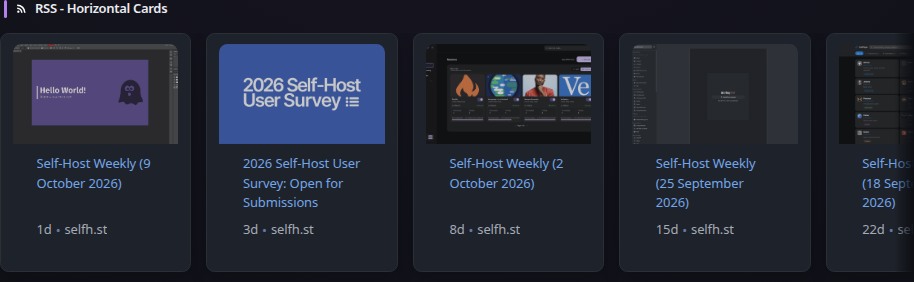
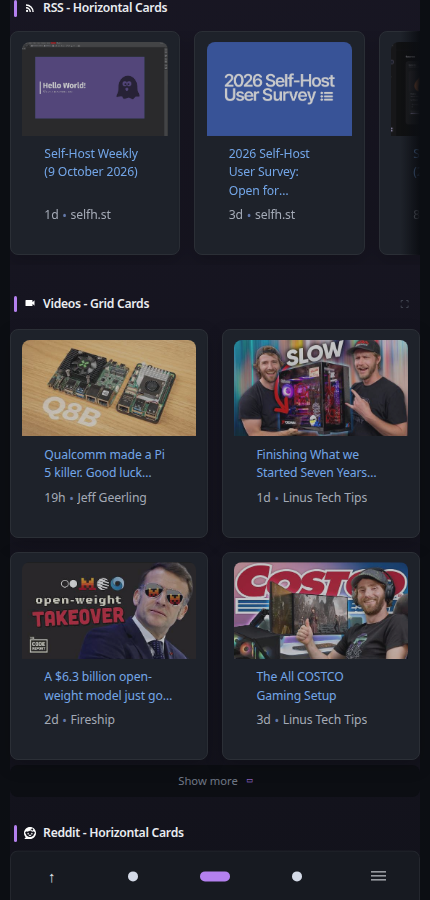
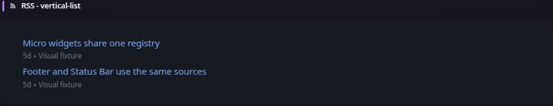
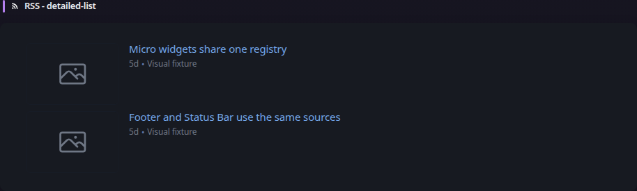
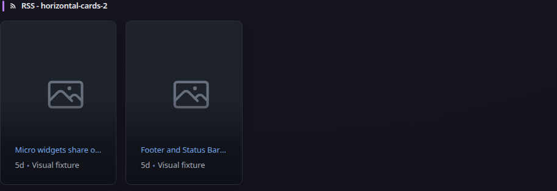

# RSS

[Widgets](../widgets.md) · [Configuration](../configuration.md) · [Glance README](../../README.md)

Display articles from one or more RSS or Atom feeds, with list and card layouts for different dashboard sizes.

## Quick start

```yaml
- type: rss
  title: News
  feeds:
    - url: https://feeds.bloomberg.com/markets/news.rss
      title: Bloomberg
    - url: https://moxie.foxbusiness.com/google-publisher/technology.xml
      title: Fox Business
```



**Mobile preview:**



## Styles

The RSS widget supports four layouts:

- `vertical-list` — compact list suitable for full and small columns
- `detailed-list` — article summaries suitable for full columns
- `horizontal-cards` — horizontally scrolling cards suitable for full columns
- `horizontal-cards-2` — alternate horizontal card layout suitable for full columns

### Vertical list




### Detailed list




### Horizontal cards


### Horizontal cards 2




## Configuration

| Property | Type | Required | Default |
| --- | --- | --- | --- |
| `style` | string | no | `vertical-list` |
| `feeds` | array | yes | — |
| `thumbnail-height` | float | no | style default |
| `card-height` | float | no | style default |
| `limit` | integer | no | `25` |
| `preserve-order` | boolean | no | `false` |
| `sort` | string | no | `chronological` |
| `rarity-base` | float | no | `72` |
| `rarity-exponent` | float | no | `2.5` |
| `single-line-titles` | boolean | no | `false` |
| `collapse-after` | integer | no | `5` |

All widgets also support the [shared widget properties](../widgets.md#shared-properties).

### `limit`

Sets the maximum number of articles displayed across the configured feeds.

### `collapse-after`

Sets how many articles are visible before the **SHOW MORE** control appears. Set it to `-1` to disable collapsing.

### `preserve-order`

When `true`, articles retain the order supplied by the feeds instead of being sorted by publication time. When combining large feeds, consider setting a per-feed `limit` so one feed does not dominate the result.

### `sort`

Controls article ordering when `preserve-order` is `false`:

- `chronological` (default): newest articles first.
- `rarity`: boosts articles from less frequently posting feeds using the median gap between returned publication dates. Feeds with only one article assume a 24-hour posting interval.
- `tier`: sorts feeds by configured integer `tier` (lower first), newest first within each tier; feeds without a tier appear last.

`preserve-order: true` takes precedence over `sort`. Sorting is applied before the widget's overall `limit`. Feed-level `limit` still restricts which articles enter the sort.

### `rarity-base`

For `sort: rarity`, the posting interval in hours that receives neutral weighting (default `72`). Zero selects the default.

### `rarity-exponent`

For `sort: rarity`, controls how strongly posting frequency changes ranking (default `2.5`). Zero selects the default.

Example:

```yaml
- type: rss
  sort: tier
  feeds:
    - url: https://example.com/important.xml
      tier: 0
    - url: https://example.com/other.xml
      tier: 1
```

### `single-line-titles`

Truncates article titles to one line when `style` is `vertical-list`.

### `thumbnail-height`

Overrides the thumbnail height for `horizontal-cards`. Values are measured in `rem`. When omitted, the built-in style determines the height.

### `card-height`

Overrides the card height for `horizontal-cards-2`. Values are measured in `rem`. When omitted, the built-in style determines the height.

## Feed configuration

Each entry in `feeds` supports its own request and presentation options.

| Property | Type | Required | Default | Notes |
| --- | --- | --- | --- | --- |
| `url` | string | yes | — | Feed URL |
| `title` | string | no | feed title | Overrides the title supplied by the feed |
| `hide-categories` | boolean | no | `false` | Applies to `detailed-list` |
| `hide-description` | boolean | no | `false` | Applies to `detailed-list` |
| `limit` | integer | no | — | Maximum articles from this feed |
| `tier` | integer | no | — | Feed priority for `sort: tier` (lower first) |
| `item-link-prefix` | string | no | — | Prefix for relative item links |
| `thumbnail-link-prefix` | string | no | — | Prefix for relative thumbnail links |
| `timeout` | duration | no | inherited | Request timeout |
| `allow-insecure` | boolean | no | `false` | Allows invalid or self-signed certificates |
| `headers` | map | no | — | Additional HTTP request headers |
| `basic-auth` | object | no | — | HTTP Basic Authentication credentials |

### Per-feed `limit`

Limits the number of articles accepted from a specific feed. This is useful when one high-volume feed would otherwise push articles from other feeds out of the widget.

### `item-link-prefix`

Adds a prefix when a feed returns relative article links and Glance cannot determine the correct base URL automatically.

### `thumbnail-link-prefix`

Adds a prefix to relative thumbnail URLs returned by the feed.

### `timeout`

Sets the maximum time to wait for this feed request. When omitted, an applicable inherited HTTP timeout may be used.

### `allow-insecure`

Allows invalid or self-signed TLS certificates when fetching this feed.

### `headers`

Adds HTTP headers to the request for a specific feed:

```yaml
- type: rss
  feeds:
    - url: https://domain.com/rss
      headers:
        User-Agent: Custom User Agent
```

### `basic-auth`

Supplies HTTP Basic Authentication credentials for a feed.

## HTTP request timeout

Configure `timeout` on entries in `feeds`, or inherit it from global/type defaults. The built-in default is 5s; explicit `0s` selects the central 5s baseline. The limit applies per HTTP request rather than to the complete refresh. See [HTTP request timeouts](../request-timeouts.md) for supported scopes, precedence, cache behavior, and exceptions.

---

[Widgets](../widgets.md) · [Configuration](../configuration.md) · [Back to top](#rss)
