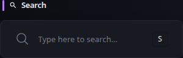
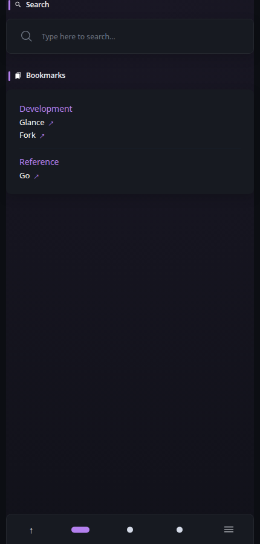

# Search Widget

[Widgets](../widgets.md) · [Configuration](../configuration.md) · [Glance README](../../README.md)

Search the web and optionally find your Glance pages and application links, with named shortcuts, suggestions, retained history, bangs, and keyboard controls.

## Quick start

```yaml
- type: search
  search-engine: duckduckgo
  bangs:
    - title: YouTube
      shortcut: "!yt"
      url: https://www.youtube.com/results?search_query={QUERY}
```

## Preview



**Mobile preview:**



## Keyboard shortcuts
| Keys | Action | Condition |
| ---- | ------ | --------- |
| <kbd>S</kbd> | Focus the first visible matching search bar | Not editing a field; no modifier keys held |
| <kbd>Enter</kbd> | Perform search in the same tab | Search input is focused and not empty |
| <kbd>Ctrl</kbd> + <kbd>Enter</kbd> | Perform search in a new tab | Search input is focused and not empty |
| <kbd>Escape</kbd> | Dismiss results, then leave focus on a second press | Search input is focused |
| <kbd>Up</kbd> / <kbd>Down</kbd> | Select a result | Results are open; Enter activates the selected result |
| <kbd>Up</kbd> | Recall the last submission on this page | No result list is open |
| <kbd>Tab</kbd> | Move focus normally | Does not select a result or trap focus |

> [!TIP]
>
> You can use the property `new-tab` with a value of `true` if you want to show search results in a new tab by default. <kbd>Ctrl</kbd> + <kbd>Enter</kbd> will then show results in the same tab.

## Configuration
| Property | Type | Required | Default |
| --- | --- | --- | --- |
| `search-engine` | string | no | `duckduckgo` |
| `new-tab` | boolean | no | `false` |
| `autofocus` | boolean | no | `false` |
| `target` | string | no | `_blank` |
| `placeholder` | string | no | `Type here to search…` |
| `open-domains` | boolean | no | `false` |
| `bangs` | array | no | — |
| `shortcuts` | array | no | — |
| `local-search` | object | no | disabled; no sources |
| `suggestions` | boolean | no | `false` |
| `suggestion-engine` | string | no | supported search-engine preset |
| `history` | object | no | storage `off` |
| `results-limit` | integer | no | `8` |
| `focus-key` | string | no | `s` |
| `use-layout` | boolean | no | `false` |

All widgets also support the [shared widget properties](../widgets.md#shared-properties).

### `search-engine`
Either a value from the table below or a URL to a custom search engine. Use `{QUERY}` to indicate where the query value gets placed.

| Name | URL |
| ---- | --- |
| duckduckgo | `https://duckduckgo.com/?q={QUERY}` |
| google | `https://www.google.com/search?q={QUERY}` |
| bing | `https://www.bing.com/search?q={QUERY}` |
| brave | `https://search.brave.com/search?q={QUERY}` |
| perplexity | `https://www.perplexity.ai/search?q={QUERY}` |
| kagi | `https://kagi.com/search?q={QUERY}` |
| startpage | `https://www.startpage.com/search?q={QUERY}` |

### `new-tab`
When set to `true`, swaps the shortcuts for showing results in the same or new tab, defaulting to showing results in a new tab.

### `autofocus`
When set to `true`, automatically focuses the search input on page load.

### `target`
The target to use when opening the search results in a new tab. Possible values are `_blank`, `_self`, `_parent` and `_top`.

### `placeholder`
When set, modifies the text displayed in the input field before typing.

### `open-domains`
When set to `true`, an input that looks like a domain or HTTP(S) URL is opened directly instead of being searched for. `example.com`, `sub.example.com:8080/path`, and `https://example.com` all navigate directly; `https://` is added when no scheme is present. The input must contain no spaces and bare hostnames such as `localhost` are still searched for. Bang searches always take precedence, and non-HTTP schemes are treated as normal search input.

### `bangs`
Bangs are shortcuts that route a query to a specific search engine or site. For example, a configured `!yt` bang can send the query directly to YouTube:


#### Bang properties
| Property | Type | Required |
| --- | --- | --- |
| `title` | string | no |
| `shortcut` | string | yes |
| `url` | string | yes |
| `raw-query` | boolean | no |

#### `title`
Optional title that will appear on the right side of the search bar when the query starts with the associated shortcut.

#### `shortcut`
Any value you wish to use as the shortcut for the search engine. It does not have to start with `!`.

> [!IMPORTANT]
>
> In YAML some characters have special meaning when placed in the beginning of a value. If your shortcut starts with `!` (and potentially some other special characters) you'll have to wrap the value in quotes:
> ```yaml
> shortcut: "!yt"
>```

#### `url`
The URL of the search engine. Use `{QUERY}` to indicate where the query value gets placed. Examples:

```yaml
url: https://www.reddit.com/search?q={QUERY}
url: https://store.steampowered.com/search/?term={QUERY}
url: https://www.amazon.com/s?k={QUERY}
```

Every occurrence of `{QUERY}` receives the same URL-encoded query. Set `raw-query: true` on a bang only when the destination needs an unencoded path, such as `https://github.com/{QUERY}` with `owner/repository`. Raw mode also preserves characters such as `&`, `#`, and `?`; use it deliberately. It does not split input into multiple arguments or interpret regular expressions.

### `shortcuts`

Named destinations appear in the result list when their title or alias matches. An exact alias followed by Enter navigates immediately. Other matches require explicit arrow-key or pointer selection; otherwise Enter still performs the typed web search. Bangs have precedence over aliases.

```yaml
shortcuts:
  - title: GitHub
    alias: gh
    url: https://github.com
  - title: Dashboard documentation
    url: /docs
```

Each shortcut requires a title and an HTTP(S) or root-relative local URL. Aliases are optional, case-insensitive, unique single words without `!`. Matching prioritizes exact matches, prefixes, substrings, then abbreviations. Selecting a bang from the list inserts its shortcut so you can supply the query.

### `local-search`

```yaml
local-search:
  sources: [pages, bookmarks, monitor, docker-containers]
  scope: dashboard
```

`sources` selects the destination types to include. Omit it to disable local results. `scope` is `page` (default), `dashboard`, or `all`. Without named dashboards, dashboard scope covers the configured pages. All scopes enforce the current user's dashboard permissions; `all` means all accessible pages. Results identify the source page, and shared pages use an accessible dashboard route. Nested widgets and Docker child containers are included.

Monitor and Docker results use their most recently published navigation destinations. Searching never triggers provider refreshes. Monitor check URLs, credentials, Docker connection details, and links hidden by Docker's configured filtering are not indexed. Check-URL-only Monitor entries without a navigation URL are omitted. Failed refreshes retain the previous published destinations. Bookmark descriptions and source page names also participate in matching. Local links retain their source widget's tab/target behavior; page results open in the same tab. Ctrl/Meta toggles same/new-tab behavior.

### `suggestions` and `suggestion-engine`

```yaml
suggestions: true
suggestion-engine: duckduckgo
```

Suggestions are disabled by default. Supported presets are `google`, `duckduckgo`, `bing`, and `startpage`. The suggestion provider is independent of the search engine: for Brave, Kagi, Perplexity, or a custom search engine, set `suggestion-engine` explicitly. For supported presets, omission uses the selected search engine.

A custom HTTP(S) endpoint must contain `{QUERY}` in a query parameter value, such as `https://suggest.example/complete?q={QUERY}`, and return either OpenSearch JSON (`["query", ["first", "second"]]`) or DuckDuckGo phrase objects (`[{"phrase":"first"}]`). Placeholders in the URL path, host, or parameter names are rejected. Configure only endpoints you trust; the server makes requests to that configured destination. The browser cannot supply an arbitrary endpoint. Redirects must retain the configured scheme, host, and effective port; cross-origin redirects and URL credentials are rejected. Set the final endpoint directly if a provider normally redirects to another origin. Provider availability and throttling can change.

Requests start after two characters and a 200 ms pause, stop for active bangs, and are cancelled when input changes or loses focus. Late responses are discarded. Responses are limited to 256 KiB, concurrent provider work to four requests per Search widget, and request duration by the shared HTTP client's timeout. Failures show a contained message while normal search and other result sources continue working. Suggestion text is displayed as text, never HTML.

Enabling suggestions sends typed query text to the selected provider through your Glance server. Local-only results and history do not require a suggestion provider. Search diagnostics contain generic failure details rather than query text or provider response bodies.

### `history`

```yaml
history:
  storage: browser
  id: home-search
  limit: 50
  retention-days: 30
```

History is disabled by default (`storage: off`). Choose `browser` for local browser storage or `server` for authenticated personal-state storage. Enabled history requires a stable `id` of 1–128 characters without slashes. Use different IDs for separate histories or the same ID to share history between Search widgets. Defaults are 50 entries and 30 days; valid limits are 1–100 entries and 1–3650 days. Expired entries are pruned on load and update. Submitted query text is retained, including the bang when present; simply typing a query or opening a local destination does not save it.

Recent history appears when focusing an empty search box. Use the arrow keys to select an entry, then **Remove selected history**, or use **Clear history** to remove every entry. Browser history is separated by Glance base URL and signed-in identity; anonymous history remains separate. People sharing the same browser and account can read its history.

Server history requires authentication and [server personal-state storage](../configuration.md#server). It uses the existing per-user atomic persistence and survives browser changes. Browser history is never automatically uploaded or used as a fallback for server history. Other tabs/devices load server history on page load; concurrent device writes follow the existing last-write-wins behavior. This is not a real-time synchronization service. Storage failures leave search usable and show that history storage is unavailable.

### `results-limit`, `focus-key`, and `use-layout`

`results-limit` caps the combined dropdown at 1–20 results (default 8). The input is an accessible combobox with arrow-key selection and result announcements. Enter submits the typed query unless a result is selected or an exact alias matches. Ctrl/Meta toggles tab behavior. IME composition does not accidentally submit or trigger suggestions.

`focus-key` accepts a lowercase letter or `none` to disable the page shortcut. With `use-layout: false`, the shortcut follows the physical key position (S by default). With `use-layout: true`, it follows the character produced by the active keyboard layout. Editing inputs, textareas, selects, and contenteditable fields suppresses the shortcut. With several matching widgets, the first visible one receives focus.

All final Search destinations, including custom search templates and raw bangs, must resolve to HTTP(S) URLs without embedded credentials. Executable schemes such as `javascript:` and `data:` are rejected before either same-tab or new-tab navigation. Root-relative local links remain supported. Raw-query mode controls query encoding; it does not bypass destination validation.

### Complete example

```yaml
- type: search
  search-engine: brave
  open-domains: true
  results-limit: 10
  focus-key: s
  use-layout: true
  shortcuts:
    - title: GitHub
      alias: gh
      url: https://github.com
  local-search:
    sources: [pages, bookmarks, monitor, docker-containers]
    scope: dashboard
  suggestions: true
  suggestion-engine: duckduckgo
  history:
    storage: browser
    id: home-search
    limit: 50
    retention-days: 30
  bangs:
    - title: GitHub repository
      shortcut: "!repo"
      url: https://github.com/{QUERY}
      raw-query: true
```


## HTTP request timeout

Configure `timeout` on the widget, or inherit it from global/type defaults. The built-in default is 5s; explicit `0s` selects the central 5s baseline. The limit applies per HTTP request rather than to the complete refresh. It applies to remote suggestions, preserving the configured-origin redirect policy. See [HTTP request timeouts](../request-timeouts.md) for supported scopes, precedence, cache behavior, and exceptions.

---

[Widgets](../widgets.md) · [Configuration](../configuration.md) · [Back to top](#search-widget)
