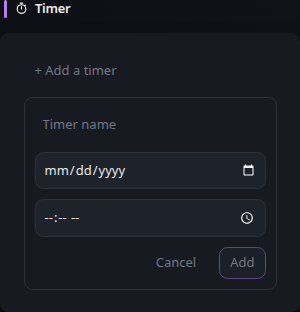
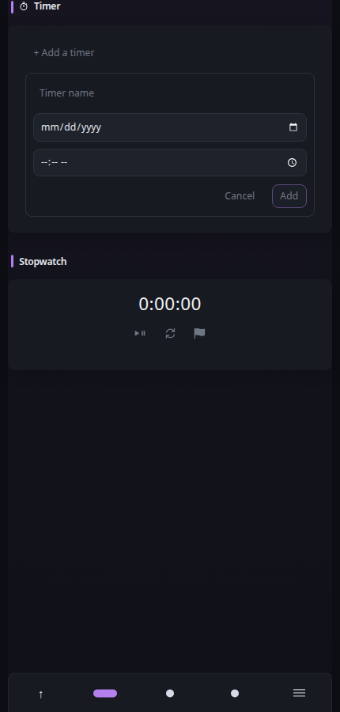

# Timer

[Widgets](../widgets.md) · [Configuration](../configuration.md) · [Glance README](../../README.md)


Create countdown timers for specific dates and times. Timers can be added, edited, deleted, and reordered directly in the widget.

Timer data is stored in the browser's local storage by default and remains specific to that browser profile. When authenticated [server-side personal state](../configuration.md#personal-state) is enabled, timer lists are stored on the server for that user and widget ID. See [`id`](#id) for migration and sharing behavior.

Example:
## Quick start


```yaml
- type: timer
  id: important-dates
  hour-format: 12h
```

Preview:



**Mobile preview:**



To edit a timer, click its name or target date and time. To reorder timers, drag and drop them by grabbing the top side of a timer. Use the trash icon to delete a timer.

Countdowns display days, hours, and minutes as applicable. Once a target time has passed, the timer remains visible and shows the elapsed time followed by `ago`.

## Configuration

This widget also supports the [shared widget properties](../widgets.md#shared-properties).

| Name | Type | Required | Default |
| ---- | ---- | -------- | ------- |
| id | string | no | |
| hour-format | string | no | 12h |

### `id`

The ID used to scope the timer list. By default, timers are stored in the browser's local storage, and Timer widgets with the same ID share the same timers in that browser profile. Specify different IDs for independent timer lists.

When authenticated [server-side personal state](../configuration.md#personal-state) is enabled, the same ID scopes the user's server-side timer list instead. Existing valid browser-local timers are migrated the first time no server value exists for that user and ID.

### `hour-format`

Whether target times are displayed in 12-hour or 24-hour format. Possible values are `12h` and `24h`.

Dates and times entered in the widget are interpreted as local calendar time in the browser. Optional server-side storage does not change this interpretation or introduce server-side timezone conversion.


---

[Widgets](../widgets.md) · [Configuration](../configuration.md) · [Back to top](#timer)
